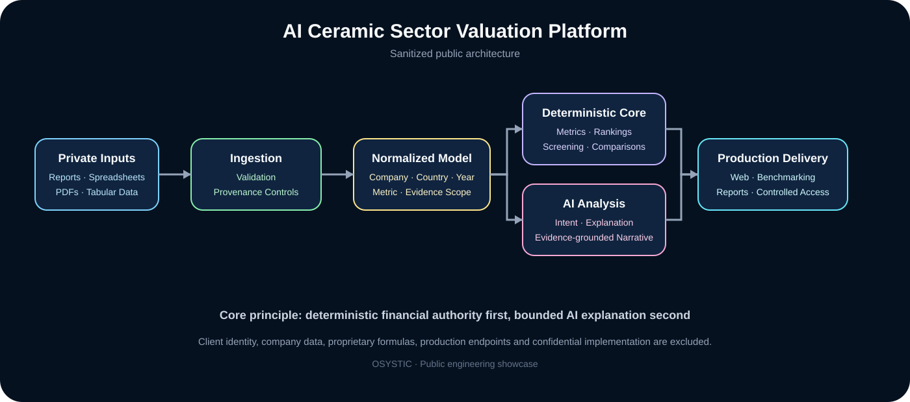

# AI Ceramic Sector Valuation Platform — Case Study

> **OSYSTIC ENGINEERING CASE STUDY · PUBLIC SHOWCASE · SANITIZED · PORTFOLIO-SAFE**

This repository documents a confidential production engagement in which OSYSTIC engineered a multi-country ceramic-sector valuation, benchmarking and AI-assisted financial-analysis platform. The private delivery source, datasets, client identity and production configuration remain confidential.

## Company showcase classification

| Attribute | Public classification |
|---|---|
| Publisher | **OSYSTIC** |
| Artifact type | Engineering case study / capability proof |
| Source engagement | Private production software delivery |
| Publication model | Sanitized public showcase with independent Git history |
| Confidential implementation | Excluded and retained privately |
| Client identity | Not disclosed |
| Intended use | Portfolio, proposals, technical due diligence, capability review |

## What was engineered

The private platform combines structured financial-data ingestion, deterministic valuation and ranking logic, cross-country benchmarking, evidence-grounded AI analysis, multilingual reporting and production-grade operational controls.

The system was designed for a ceramic-sector dataset spanning multiple European markets and multi-year company financial records. It supports structured analytical queries, free-text analysis, benchmarking, ranking, forecast-oriented workflows, document ingestion, report export and controlled commercial access.

## High-level architecture

Private financial reports / spreadsheets / PDFs
→ ingestion and provenance controls
→ normalized sector/company data model
→ deterministic metrics and ranking engines
→ AI-assisted analytical channels
→ benchmarking, screening and forecasting
→ web application and report export
→ private production environment

## Engineering highlights

- **Deterministic-before-generative design:** core financial calculations and ranking behavior remain explicit and testable before AI-generated narrative is layered on top.
- **Multi-country comparability:** the platform normalizes sector data across more than one country while preserving country-specific context.
- **Evidence-grounded analysis:** analytical responses are constrained by structured source data, document evidence and validated metric definitions.
- **Document/data ingestion:** spreadsheets, PDFs, CSV/tabular sources and document-based reference material feed controlled ingestion pipelines.
- **Multilingual output:** the delivery supports multilingual analytical and report-generation workflows.
- **Operational reporting:** results can be rendered in the web application and exported into structured report formats.
- **Commercial access controls:** the production platform includes controlled account/access and usage-credit workflows without exposing those implementation details publicly.
- **Release discipline:** production changes are protected by privacy checks, compilation, deterministic regression tests and documented rollback/data-refresh procedures.

## Production outcome

The confidential source repository identifies the platform as a production environment with an M5.5 stable baseline under continued maintenance. This public case study describes the engineering system at a capability level only and does not expose private deployment identifiers or client-specific acceptance criteria.

## Public vs. private repository boundary

| Area | This public showcase | Confidential engineering repository |
|---|---|---|
| Visibility | **Public** | **Private** |
| Purpose | Portfolio and capability proof | Production source and maintenance |
| Application source | **Not included** | Retained privately |
| Financial datasets | **Not included** | Controlled/private |
| Client identity and branding | **Not included** | Controlled/private |
| Proprietary ranking/valuation implementation | **Not included** | Controlled/private |
| Production configuration | **Not included** | Controlled/private |
| Commercial/payment configuration | **Not included** | Controlled/private |
| Sanitized architecture and lessons | Included | Also documented privately |
| Safe to share publicly | **Yes** | **No** |

This public repository is not a fork, mirror or source export. It has **independent Git history** and contains only sanitized documentation and diagrams.

## Technology

Python · FastAPI · Uvicorn · Jinja2 · OpenPyXL · PDFPlumber · PyPDF · PyMuPDF · Tesseract OCR integration · python-docx · OpenAI-compatible APIs · Stripe integration · GitHub Actions

## Validation boundary

The private delivery repository contains the confidential source, authorized production inputs, release evidence and regression suites. This public repository validates only its disclosure-safe documentation boundary.

> This case study does not reproduce private financial results, company rankings, production credentials, private datasets or proprietary calculation rules.

## What is intentionally not claimed

This showcase does **not** claim:

- investment advice or guaranteed valuation accuracy;
- financial returns, alpha, ROI or trading performance;
- that public readers can reproduce private company-level results from this repository;
- redistribution rights for source financial statements or licensed/private datasets;
- that AI-generated narrative replaces deterministic financial validation;
- that the public repository contains the client-delivery source;
- disclosure of proprietary ranking formulas or client-specific business rules.

## Read more

- [Full case study](case-study.md)
- [Technical overview](docs/technical-overview.md)
- [Delivery evolution](docs/research-evolution.md)
- [Engineering lessons learned](docs/lessons-learned.md)
- [Repository hardening](docs/repository-hardening.md)
- [Validation evidence](docs/validation-evidence.md)
- [Disclosure boundary](docs/disclosure-boundary.md)
- [Standardization acceptance](docs/standardization-acceptance.md)
- [Publication and reuse notice](NOTICE.md)

## Disclosure boundary

Only sanitized architecture, engineering decisions, validation approach, delivery evolution, production-governance lessons and capability descriptions are published here. Confidential implementation source, private datasets, client identity, credentials, production infrastructure, contract/commercial details and private repository history are intentionally excluded.
